# Fleet refactoring plan: shared modules

What to extract into shared modules, in what order, and how to prove each
step changed nothing it should not have. Written against `main` at `16c2d7b`
and the open pull requests as of 2026-11-08, then revised against an
adversarial review of the first draft (its findings are folded in below; the
PR that carries this file has the review thread).

This supersedes the survey in #39 and the checklist in #40: both predate
`luks-remote-unlock.nix`, the agent modules, the fleet registry (#107) and the
decision to rebuild the Pis as resolver replicas (`hosts/hopper/DECISIONS.md`
§5). Where this plan and `docs/FLEET-REGISTRY.md` (#232) describe the same
work, the registry doc owns the registry's shape and this one owns the order.

## 1. Ground rules

**One concern per PR, scoped as `CLAUDE.md` says.** Every item below is sized
to be one PR. An item that changes what a host runs names the hosts that must
switch, and its PR title names the host at risk first.

**Pure refactors are proven, not asserted.** The proof is that each host's
system closure is the same before and after. Two things make this harder than
it sounds, and both have bitten PRs here already:

- `toplevel.drvPath` is not a usable no-op check in this repo. `motd.nix`
  bakes the flake's source identity into the closure, so two byte-identical
  checkouts evaluate to different paths (#105 found this; #107 and #232 worked
  around it). The working method is: `git archive` both trees, evaluate each
  as a `path:` flake, and compare toplevel paths per host. `motd.nix` falls
  back to `"unknown"` when `self.rev` is absent, and nothing else reads `self`
  as a path, so the comparison is exact. For a change that is meant to be a
  no-op on some hosts and not others, the per-host table in #107's description
  is the shape to copy.
- galactica only evaluates where the private `nixflix` input can be fetched:
  in CI, which holds a token, or in a web session that has attached
  `zjones-xyz/nixflix-exp` (`CLAUDE.md`, Workflow). A session that has not
  cannot, and today CI does not compare anything: `nix-check.yml` evaluates
  each toplevel and builds memory-alpha, nothing more. So "CI is green" proves
  galactica evaluates, not that a refactor left it unchanged. W0 closes that
  gap with a CI job before any galactica refactor starts, and every galactica
  item below cites that job as its proof. The NixOS cloud environment now
  lists `nixflix-exp`, so a session started with it selected evaluates
  galactica without the manual attach. W20 removes the private input
  altogether.

**Delete before abstracting.** #39's one piece of advice that still holds. The
Pi era-1 modules are not refactor candidates; they are deletions waiting on the
resolver rebuild (W13), and no item below spends effort generalising them.

**galactica is on production Let's Encrypt.** `homelab.letsencryptStaging =
false` there. Any Traefik change that alters a router's `tls` block, its
`domains` list, or the resolver's name re-issues certificates against the
production limit of 50 per registered domain per week, with every group
sharing `zjones.dev`. W6 through W9 each say what they do to keep the TLS
configuration byte-identical.

**A deployed host is the only real test for anything with runtime behaviour.**
W5, W9, W10, W13 and W14 change what runs. They carry deploy checklists and go
one host at a time.

**Review cost is a design input.** Every PR here goes through
`merge-after-review`: a fresh adversarial reviewer plus CI, and a new
reviewer for every fix round. The follow-up commits after #244 and #245 were
all run-book wording caught on a second or third full review. W17 to W19
spend the reviewer's attention on what a machine cannot check, and the
"while I'm in here" addition that grows a PR past its item is the single
largest avoidable review cost, so it is out of scope for every item.

## 2. Open PRs this plan builds on, or retires

Checked against `main` with `git merge-tree` on 2026-11-08. "Unverified" means
the branch has no merge base in the shallow clone used for this check.

| PR | What it does | vs `main` | This plan |
|---|---|---|---|
| #105 | Shared `homelab.letsencryptEmail` and `letsencryptCaServer` in all four Traefik modules | clean | Merge first. W6 assumes it. |
| #107 | Fleet registry Phase 1: `fleet/{hosts,services,lib}.nix`, `modules/nixos/fleet.nix`, generated AdGuard rewrites | clean | Merge first. W7 and W12 build on it. |
| #232 | Registry follow-ups: plane names `internal`/`private`/`public`, `docs/FLEET-REGISTRY.md` roadmap | stacked on #107; conflicts with `main` in `hosts/memory-alpha/MANUAL-STEPS.md` | Rebase onto `main` once #107 merges, then merge. |
| #205 | SSH public keys only, boot generation cap | carries stale copies of #107's first two commits, not a true stack; clean today, conflicts the moment #107 merges | Rebase onto `main` dropping the two copied commits. Unrelated to this plan but touches `common.nix`, so land it before W4. |
| #207 | galactica beszel-agent via the socket proxy, proxy off the shared network | conflicts | Rebase and merge before W5 and W10: it adds the `dockerHost` option W10 keeps. |
| #208 | memory-alpha socket proxy on its own compose network, pinned | clean | Merge before W9, which replaces the compose file it edits. |
| #209 | `homelab.alerts`: ZED, smartd and failed-unit alerts to ntfy | clean | Merge. W14 uses it instead of `nut.nix`'s own ntfy script. |
| #255 | Review friction: docs-only CI skip, union merges for run books, REST path in `merge-after-review`, branch hook | clean | Merge. The CI skip and union merges pay back on every PR below. |
| #257 | `checks/lint`: shellcheck, actionlint, deadnix, statix in CI; ten findings fixed as no-ops | clean; touches the same `CLAUDE.md` bullets as #255, so whichever lands second merges `main` in | Merge. It is W17's lint half. |
| #139 | `nrs`/`nrt`/`drs` through `scripts/nrebuild.sh` with a branch banner | unverified | Decide before W3. W3 generates whatever alias shape #139 settles on. |
| #36 | pegasus Beszel agent via nixpkgs' native `services.beszel.agent` | unverified, Aug 2026 | Superseded by `beszel-agent.nix` on `main`. Close, but W10 takes its finding: nixpkgs has a native agent module. |
| #84 | Colmena hive | conflicts, galactica missing | Park. W4's `mkHost` should expose each host's module list so `colmena.nix` can consume it instead of re-listing modules, which was #84's stated pain. Revisit after W4. |
| #141 | Home Assistant on memory-alpha as a compose-in-systemd container | unverified, large | Not a refactor PR, but its `home-assistant.nix` is a future W8 consumer and it edits `traefik.nix`, so it lands before W9 or is rebased after, never during. |
| #129, #144 | Syncthing peers; ChatGPT desktop package | unverified | Both rewrite `hosts/pegasus/home.nix` heavily. Land or close before W3 and W16 touch that file. |
| #39 / #40 | Unification survey and tracking issue | docs only | Close #39. Replace #40's checklist with a pointer here, or close it. |

Everything else open (#26, #73, #113, #156, #159, #174, #176, #190, #204,
#224, #227, #231, #235 to #238, #242, #244, #245) is host work that does not
overlap this plan, except that #174 touches `smart.nix` and #156 adds
containers to memory-alpha; neither changes what follows.

## 3. Work items

Each item: what it extracts, the files it touches, what proves it, which hosts
switch, and what it depends on. "No-op" means every host's toplevel is
unchanged by the W0 check.

### W0. No-op proof: script and CI job

Two halves, one PR.

`scripts/eval-diff.sh <ref-a> <ref-b>`: `git archive` both refs into scratch
directories, evaluate every `nixosConfigurations.*` and
`darwinConfigurations.*` toplevel as a `path:` flake, and print a per-host
changed/unchanged table. Optional `--units` diffs `/etc/systemd/system` and
`/etc/systemd/user` between the two closures' `etc` outputs, which is the
useful view for a change that replaces one unit with another. Reuses the
git+https rewrite from `.claude/hooks/flake-check-sandboxed.sh` so it works
in a sandboxed session for every host, galactica included once the session
has attached `zjones-xyz/nixflix-exp`.

A CI job in `nix-check.yml`, on pull requests only, that runs the same script
on the PR's merge base against its head. CI holds `NIXFLIX_EXP_TOKEN`, so
galactica is always comparable there. The job posts the per-host table
as a step summary. It does not fail the run: a refactor PR cites the table as
its proof, a behaviour-changing PR cites it as its blast radius.

The registry roadmap's "CI no-op guard" (a flake check asserting galactica's
rewrite set) is a different thing and stays in W12.

- Files: `scripts/eval-diff.sh`, `.github/workflows/nix-check.yml`,
  `CLAUDE.md` (one line under Workflow).
- Proof: run it on `main` against `main`, every host unchanged; run it on
  #105's branch against its base, every host unchanged; run it on #107's
  branch, the table matches the one in #107's description.
- Hosts: none.
- Depends on: nothing. It is the first PR, before any of the open PRs in
  section 2 merge, so each of them gets a CI table too.

### W1. Tailscale client module

`modules/nixos/tailscale.nix` becomes `homelab.tailscale = { enable; exitNode
= false; ssh = true; }`. It owns the sops secret, `services.tailscale`,
`trustedInterfaces` and the UDP port. `useRoutingFeatures = "server"`, the
`--advertise-exit-node` flag and the two forwarding sysctls are gated on
`exitNode`; hopper sets it. pegasus and galactica drop their hand-written
blocks. hamilton has no `--ssh` today, so it sets `ssh = false` to stay a
no-op, with a one-line note that turning it on is a deliberate change. The
secret name stays `tailscale/authKey`, which `tsdproxy.nix` also reads by
default. pegasus's printer-discovery UDP ports stay in its configuration.

- Files: `modules/nixos/tailscale.nix`, four `configuration.nix`.
- Proof: no-op on all four hosts.
- Hosts: none switch for the refactor itself.
- Depends on: W0.

### W2. Borgmatic fleet module

`modules/nixos/borgmatic.nix`, `homelab.borgmatic`, owning what the three host
files share: the BorgBase repository URL built from an account id, the archive
name format derived from the label, `encryption_passcommand`, the `ssh_command`
with the pinned `known_hosts`, zstd, cache excludes, `skip_actions = compact`,
the `checks` list, both sops secrets at `/var/lib/borgmatic/ssh/`, the
`LoadCredentialEncrypted` reset and the `OnCalendar` reset. Per-host options:
`configName` (galactica and memory-alpha use `offsite`, pegasus uses
`pegasus-home`, and the rendered file is named after it), `repoAccount`,
`label`, `schedule`, `retention`, `secretsOwner`, a free `settings` attrset
merged last for the ZFS hook, the SQLite dumps and the path excludes, and a
`serviceConfig` passthrough for galactica's `PrivateDevices = mkForce false`
and each host's capability set.

`docs/BACKUP.md`'s `archive_name_format` warning stays. It is about several
per-service configs sharing one repository and how borgmatic derives
`match_archives`, an unverified hazard this module does not touch.

- Files: new module, three `hosts/*/borgmatic.nix` shrink to their
  differences.
- Proof: no-op on galactica, memory-alpha, pegasus. `services.borgmatic`
  renders each config to a store path, so the rendered YAML can be diffed
  directly as a second check.
- Hosts: none switch for the refactor itself.
- Depends on: W0.

### W3. Fleet rebuild aliases as a Home Manager module

`modules/home/fleet-aliases.nix` with options `flakeAttr` and `repoPath`,
generating `nrs`, `nrt`, `npull`, `npullnrs`, or `drs`/`npulldrs` on darwin.
`flakeAttr` is explicit rather than read from `osConfig.networking.hostName`:
serenity's hostname is `Serenity` and its flake attribute is `serenity`. The
`unlock-*` and `ipmi-tower-*` recovery aliases are generated from one list of
targets minus the host itself, so pegasus keeps not having `unlock-pegasus`
and serenity keeps all three; one definition, deliberately present on both
admin boxes (`hosts/galactica/PLATFORM.md` §2). galactica, hamilton, hopper
and memory-alpha `home.nix` reduce to a stateVersion and the module import.

- Files: new module, six `home.nix`.
- Proof: no-op on all hosts. The rendered `home.shellAliases` can be
  compared as a second check.
- Hosts: none.
- Depends on: W0, a decision on #139 (the alias target changes from
  `sudo nixos-rebuild` to `nrebuild.sh`), and #129/#144 landed or closed since
  they rewrite pegasus's `home.nix`.

### W4. Host boilerplate and `mkHost`

Three mechanical lifts. `common.nix` derives `sops.defaultSopsFile` from the
hostname and sets `age.sshKeyPaths`. `common.nix` sets the home-manager
`useGlobalPkgs`/`useUserPackages` pair and each host keeps a one-line
`home-manager.users.z = import ./home.nix` (the path-from-hostname trick is
not worth a reader's lookup). `flake.nix` gains `mkHost { system; modules;
extraSpecialArgs ? {}; hmSharedModules ? [] }` wrapping `nixosSystem`,
home-manager, `appsForHm` and sops-nix, and exposes the per-host module list
as `self.lib.hostModules.<host>` so a future Colmena hive (#84) can read it.
pegasus's `hasSops` gate in its borgmatic file goes here if W2 has not already
removed it.

- Files: `flake.nix`, `modules/nixos/common.nix`, five `configuration.nix`,
  `hosts/pegasus/borgmatic.nix`.
- Proof: no-op on all hosts.
- Hosts: none.
- Depends on: W0; #205 merged first since it also edits `common.nix`.

### W5. Declarative Docker networks

`homelab.docker.networks.<name> = { options ? ""; bridgeName ? null; user ?
"root"; consumers = [ units ]; recreate ? false; }` generates the
inspect-or-create oneshot, named `docker-<name>-network.service` so the
existing `docker-proxy-network.service` keeps its name: `obico.nix`,
`arcane.nix`, `bambuddy.nix` and `reading-library.nix` depend on it by name.

The default behaviour adopts an existing network as-is. Bambuddy's label-hash
recreate logic is available behind `recreate = true` and is used only by the
`bambuddy-lan` network that already has it: `docker network rm` fails while
any container is attached, and on memory-alpha `proxy` carries Arcane, obico,
bambuddy and every `homelab-stacks` compose project Arcane manages outside
this repo. memory-alpha's `proxy` keeps `bridgeName = "br-proxy"`, which its
firewall trusts, and `user = "z"` so its unit is unchanged. The `proxy` network
is declared by the Traefik module (W6) and consumers add themselves.

Scope is galactica and memory-alpha only. `traefik-local.nix` and
`traefik-hamilton.nix` run their oneshot as `z` against the rootless socket;
they are W13 deletions and are not generalised.

`virtualisation.oci-containers.backend = "docker"` moves to `common.nix`
beside `docker.enable`.

- Files: new `modules/nixos/docker-networks.nix`, `traefik.nix`,
  `traefik-galactica.nix`, `karakeep.nix`, `paperless.nix`, `bambuddy.nix`,
  `common.nix`.
- Proof: no-op on both hosts is the target. If the generated `ExecStart`
  differs textually from a hand-written one, the W0 `--units` diff shows the
  unit and nothing else, and the PR body quotes it.
- Hosts: galactica and memory-alpha switch if any unit text changed; the
  oneshot is `RemainAfterExit` and a changed unit restarts it, which is a
  no-op against an existing network.
- Depends on: W0, #207 and #208 merged (they move the socket proxy's
  network).
- PR title: `[galactica, memory-alpha] …`.

### W6. One Traefik module, galactica first

`traefik-galactica.nix` becomes `modules/nixos/traefik.nix`, option prefix
`homelab.traefik`, with: `domainGroups.<name> = { base; flat = false;
upstreams; }` generalising `mkDomainGroup`; `dashboard = { enable;
authSecret; }` for the memory-alpha style basic-auth dashboard;
`dockerProvider.enable`; `extraRouters` for the few hand-shaped routes like
`jellyfin-xyz`. `arrExtraUpstreams` and `readUpstreams` become
`domainGroups.arr.upstreams` and `domainGroups.read.upstreams`, with the old
names kept as aliases for one release. The old compose `traefik.nix` is
renamed `traefik-compose.nix` until W9 deletes it, so the name is free.

A `flat` group renders `name.internal` and `name.zjones.dev` and sets no
`tls.domains` on its `-dev` routers. That matches what every flat router on
galactica does today (its own single-name certificate) and is what keeps
this step from re-issuing anything against production. Wildcard groups keep
their `domains` list exactly as now.

- Files: `modules/nixos/traefik-galactica.nix` (renamed), `traefik.nix`
  (renamed), galactica's imports, `bazarr.nix`, `reading-*.nix`.
- Proof: no-op on galactica via the W0 CI table. Standalone eval of the
  module in a minimal NixOS config shows the rendered dynamic config identical
  for the `arr` and `read` groups and a flat group rendering with no
  `domains`.
- Hosts: none switch.
- Depends on: W0, #105, W5.

### W7. galactica routes from the registry (registry Phase 2)

Every galactica service that today hand-writes a flat router pair registers an
upstream instead, and the module joins that with `fleet/services.nix` to
produce the routers: `homelab.traefik.routes.<name>.upstream = "http://
127.0.0.1:3020"` in the service's own file keeps the port written once where
the service is defined, and the registry stays the authority on names and
planes.

Assertions, scoped to what the registry can express: every registry service
with `scope = flat` or `host` whose `host` is this machine has a `routes`
entry here, and every `routes` entry names a registry service. The `arr`,
`read` and `maker` wildcard groups are `domainGroups`, outside the assertion,
because `fleet/lib.nix` has no wildcard scope until W12. `maker`'s three
upstreams move from their hand-written router blocks into
`domainGroups.maker.upstreams` in this step. `adguard`'s pair in
`configuration.nix` moves to `dns.nix` as `homelab.dns.adminRoute = true`,
since hopper and hamilton's Traefik modules hand-write the same pair.

This settles `docs/FLEET-REGISTRY.md`'s open decision 1: Phase 2 is galactica
routes from the registry; Phase 3 is memory-alpha and `jellyfin.internal`
(W9).

- Files: ten `hosts/galactica/*.nix`, `homepages.nix`, `configuration.nix`,
  `dns.nix`, `modules/nixos/traefik.nix`, `fleet/services.nix`,
  `docs/FLEET-REGISTRY.md`.
- Proof: no-op on galactica via the W0 CI table: same router names, same
  rules, same services, same `tls` blocks. Rendered `dynamicConfigOptions`
  compared sorted on a standalone eval as the second check.
- Hosts: none switch.
- Depends on: W6, #107, #232.

### W8. Proxied-container helper

`homelab.containers.<name> = { image; port; containerPort; dataDir; owner ?
root; environment; secretEnv ? {}; templateName ? "<name>.env"; extraVolumes;
extraTmpfiles; tsdproxy ? true; }` generates the tmpfiles rule,
`RequiresMountsFor`, the loopback publish, the tsdproxy label triple, the
sops env template when `secretEnv` is non-empty, and the W7 route
registration. It asserts loopback ports are unique on the host, replacing the
"next free slot" comments.

Constraints the first consumers impose: `templateName` exists because
`flake.nix`'s `checks.homepage-config` reads `homepage-admin.env` and
`homepage-guest.env` by name; ferdium, memos and spoolman have no secrets and
must produce no template; partdb's four uid-33 directories go in
`extraTmpfiles`. karakeep and paperless use it for their web container and
keep their sidecars as plain `oci-containers`; syncthing stays hand-written
because of host networking; bambuddy on memory-alpha follows after W9. #141's
Home Assistant and #156's slicers are later consumers.

- Files: new `modules/nixos/containers.nix`, ten galactica files.
- Proof: no-op on galactica via the W0 CI table, container by container.
- Hosts: none switch.
- Depends on: W5, W7.

### W9. memory-alpha onto the shared Traefik module (registry Phase 3)

Replace the compose stack in `traefik-compose.nix` with `homelab.traefik` on
memory-alpha. This is the one Traefik step with runtime risk, so it is its own
PR with a deploy checklist in `hosts/memory-alpha/MANUAL-STEPS.md`:

- The resolver stays named `letsencrypt`: `acme.json` is keyed by resolver,
  and a rename re-issues everything. Before the switch, copy
  `/home/z/traefik/letsencrypt/acme.json` to `/var/lib/traefik/acme.json`,
  owner `traefik`, mode 0600. The staging flag's separate storage path makes a
  dry run against staging possible first.
- The three wildcard SANs (`memory-alpha`, `monitor`, `3dp`) become three
  `domainGroups` with the same `main`/`sans` each, so the `domains` lists
  Traefik sees are unchanged. `jellyfin` and `jellyfin-xyz` come from the
  registry's `private` and `public` planes via `routes`, and
  `jellyfin.internal` turns on, which is the registry roadmap's Phase 3 item.
- Middlewares change provider namespace. `secure-headers@docker` and
  `dashboard-auth@docker` become `@file`. Any label in `homelab-stacks` that
  references them (the Scrutiny hub's routers carry `dashboard-auth`) must be
  edited in the same cutover, so the checklist's first step is
  `grep -rn 'dashboard-auth\|secure-headers' ~/homelab-stacks/memory-alpha`.
- The Docker provider stays: Arcane and the `homelab-stacks` projects publish
  routes by label, and `--providers.docker.network=proxy` and the `br-proxy`
  trusted interface must survive. The socket proxy from #208 stays and moves
  to loopback as on galactica.
- `host.docker.internal:8096` becomes `127.0.0.1:8096`. `arcane.nix`'s
  `after = [ "traefik-docker.service" ]` becomes `traefik.service`.

- Files: `traefik-compose.nix` deleted, `hosts/memory-alpha/configuration.nix`,
  `jellyfin.nix`, `arcane.nix`, `fleet/services.nix`,
  `hosts/memory-alpha/MANUAL-STEPS.md`.
- Proof: not a no-op. The W0 `--units` diff shows `traefik-docker.service`
  gone and `traefik.service` added, and nothing else. The rendered dynamic
  config lists the same router rules and the same `domains` lists as the old
  compose labels, plus `jellyfin.internal`.
- Hosts: memory-alpha switches, with the acme.json copy and the
  `homelab-stacks` grep first. Expect one edge restart.
- Depends on: W6, W7, #208; #141 landed or rebased.
- PR title: `[memory-alpha] …`.

### W10. Agents off compose

Three of the four compose-in-systemd agents become plain containers;
the fourth stays.

- `beszel-agent.nix` moves to nixpkgs' `services.beszel.agent`, the shape
  #248 landed on pegasus: KEY and TOKEN from a `sops.templates` env file,
  `HUB_URL` to the fleet hub, no Docker group. galactica differs in wanting
  the containers view, so its env file also carries `DOCKER_HOST` at #207's
  socket proxy; how a host-side unit reaches a proxy that lives on a Docker
  network is the one detail W10 has to settle.
- `arcane-agent.nix` and `scrutiny-collector.nix` become `oci-containers`
  entries with `sops.templates` env files, the shape `tsdproxy.nix` already
  uses. scrutiny keeps `--privileged` and its two capabilities in
  `extraOptions`. The compose wrapper, `ExecStop` and secret-export script
  go. The `dockerHost` option from #207 stays.
- `adguardhome-sync.nix` stays as it is. Its unit logs into the GL.iNet
  replica with curl at start to obtain a session cookie and then renders its
  config with `envsubst`; that is a real `preStart`, not an env file, and the
  compose wrapper is the least of it.

- Files: three modules.
- Proof: not a no-op. Per host, the W0 `--units` diff shows each `X.service`
  replaced by `docker-X.service`, and the rendered container environment
  matches the old compose environment key for key.
- Hosts: galactica and pegasus switch (memory-alpha's agents live in
  `homelab-stacks`, outside this repo). pegasus only for its Scrutiny
  collector; its Beszel agent is #248.
- Depends on: #207, #248; W8 only for consistency of shape.
- PR title: `[galactica, pegasus] …`.

### W11. NFS client mounts

`homelab.nfsMounts.<path> = { export; extraOptions ? []; }` with the fleet's
eleven default options. memory-alpha's two mounts and bambuddy's library mount
use it; bambuddy's missing `rsize`/`wsize`/`async`/`nconnect` become either an
explicit opt-out or are adopted, and the PR says which.

- Files: new `modules/nixos/nfs-mounts.nix`, `hosts/memory-alpha/
  configuration.nix`, `bambuddy.nix`.
- Proof: no-op if the options are kept per mount; otherwise the W0 `--units`
  diff shows only the three `.mount` units.
- Hosts: memory-alpha if options change.
- Depends on: W0.

### W12. Registry coverage

From `docs/FLEET-REGISTRY.md`: a wildcard-group scope so `*.maker`, `read.*`
and `*.3dp` come from the registry; host identities (`galactica`/`tower`/
`arr`, `hopper.internal`) from `hosts.nix`; and the rewrites-snapshot flake
check, the roadmap's "CI no-op guard". After this, galactica's hand-written
rewrite list is empty, the `maker` group in W7 collapses into the registry,
and W7's assertions extend to wildcard groups.

- Files: `fleet/*.nix`, `modules/nixos/fleet.nix`, `configuration.nix`,
  `modules/nixos/traefik.nix`, `checks/rewrites-snapshot/`,
  `.github/workflows/nix-check.yml` (a build step for the new check).
- Proof: no-op on galactica via the W0 CI table (rewrite set identical,
  compared sorted).
- Hosts: none.
- Depends on: W7, #232.

### W13. Pi era-1 modules: delete, after the resolver rebuild decision

`hosts/hopper/DECISIONS.md` §5 says the Pis return as ephemeral resolver
replicas and that the module set must be trimmed to resolver plus Tailscale.
Once that decision is executed, `beszel.nix`, `ntfy.nix`, `uptime-kuma.nix`,
`homepage.nix`, `speedtest-tracker.nix`, `traefik-local.nix`,
`traefik-hamilton.nix` and the rootless-Docker assumptions in them are
deleted. The Pis import `dns.nix` with `adminRoute` (W7) and the shared
Traefik module (W6) for that one pair, or no Traefik at all if the AdGuard UI
is reached over Tailscale only. `nut.nix` is deleted after W14 salvages it.

- Files: eight modules, two `configuration.nix`, `rpi-common.nix` stays.
- Proof: hopper and hamilton toplevels change; nothing else does.
- Hosts: the Pis, as part of their rebuild.
- Depends on: W1, W6, W7, W14, and the owner's decision in hopper DECISIONS
  §5 item 1.

### W14. NUT server module for galactica

`hosts/galactica/MANUAL-STEPS.md` §6 wants galactica as the UPS server, and
`configuration.nix` says `nut.nix` is hopper's own config, not a template.
Make it one: `homelab.nut.server = { upsName; driver; description; listen ?
"127.0.0.1"; monitorUser ? "upsmon"; openFirewall ? false; }` with
notifications through `homelab.alerts` (#209) instead of `nut.nix`'s own curl
script. The three extra options are what §6 needs: `listen = "0.0.0.0"`,
`monitorUser = "monuser"`, port 3493 open. hopper's module becomes the first
(dead) consumer at the defaults and galactica the live one when its UPS steps
are done.

- Files: `modules/nixos/nut.nix` rewritten, `nut-client.nix` unchanged.
- Proof: hopper changes only in the notify path; galactica gains units.
- Hosts: galactica, when §6 is executed.
- Depends on: #209; W13 deletes the old copy afterwards.

### W15. Move `service-hardening.nix` out of the host directory

`hosts/galactica/service-hardening.nix` is a generic systemd hardening set.
It moves to `modules/nixos/service-hardening.nix`, flat like every other
module, and the two importers update.

- Proof: no-op on galactica.
- Depends on: W0.

### W16. `modules/home/desktop.nix`

#40 step 4, still valid but smaller than #40 counted: the Home Manager
package overlap between pegasus and serenity is `sl`, `claude-code`,
`freeipmi`, `expect` and `unzip`. `nmap`, `sops` and `_1password-cli` are
system-level on pegasus (`environment.systemPackages`, `common.nix`,
`programs._1password`) and moving them into Home Manager would change its
profile. GUI apps stay per host for the cask-versus-nixpkgs reason #40
records.

- Proof: no-op on pegasus and serenity.
- Depends on: W0; #129/#144 landed or closed first. Independent of
  everything else.

### W16a. Shared terminal settings: `modules/home/kitty.nix`

The one place where "written once" pays off across pegasus and serenity
today is settings, not packages: `modules/home/common.nix` sets the fleet's
kitty colours in `programs.kitty.settings`, but nothing enables kitty on
serenity, whose kitty is the Homebrew cask, so the Mac gets none of it. A
shared module takes pegasus's kitty layout and keybindings and `common.nix`'s
colours, sets `programs.kitty.enable = true`, and on darwin `package = null`
so the cask keeps supplying the app. pegasus keeps its `shell`/`SHELL` lines.
The kitty comment in `modules/darwin/homebrew.nix` is corrected: Home
Manager's `targets.darwin.copyApps` (default on at serenity's
`stateVersion`) addresses the Spotlight indexing it cites.

A shared GUI *roster* was assessed and rejected: fourteen apps overlap, eight
are cask-only under different names, four carry pegasus-only GPU or version
overrides, and a roster makes nothing shorter. Revisit only if a third
desktop host appears. The real parity gap is the apps serenity has outside
nix (calibre, filebot, arduino-ide, proton-vpn, dropbox, zoom and others
under "Replicated from Serenity's /Applications" in pegasus's `home.nix`);
that is a list to decide cask-or-none on, not a module.

- Files: `modules/home/kitty.nix` (new), `modules/home/common.nix`,
  `hosts/pegasus/home.nix`, `hosts/serenity/home.nix`,
  `modules/darwin/homebrew.nix` (comment).
- Proof: no-op on pegasus (W0). On serenity, Home Manager gains
  `~/.config/kitty/kitty.conf` and nothing else; check that the ctrl+shift
  binds do not collide with macOS cmd binds.
- Hosts: serenity switches.
- Depends on: W0, W16.
- PR title: `[serenity] …`.

### W17. Lint and convention checks in CI

Two halves. The tooling half is #257: `checks.x86_64-linux.lint`
(`checks/lint/`) runs shellcheck at warning severity as bash, actionlint,
deadnix with `--no-lambda-pattern-names` (otherwise every unused `lib`,
`pkgs` or `config` in the mandated module signature is a finding) and statix
with W20 `repeated_keys` disabled (the repo writes `boot.loader.x` and
`boot.binfmt.y` as separate keys so each carries its comment). One CI step
builds it right after the Nix install, before evaluation. The ten findings
on `main` were fixed in the same PR, and every host's toplevel drvPath was
shown identical on `git archive` exports of both trees.

The convention half is the rest of this item: the mechanical rules of
`CLAUDE.md` that no off-the-shelf tool knows, as a fast job in
`nix-check.yml` before the Nix install, so it answers in seconds and the
reviewer never spends a round on it:

- PR title scope against touched paths: a `[pegasus]` PR that edits
  `modules/nixos/` or `modules/home/` is misfiled; `/dashboard`, `/dns` and
  `/dhcp` suffixes present when and only when the matching entries change.
- A new `MANUAL-STEPS.md` section is keyed `## #<N>` with N the PR's own
  number, and its pending steps are `1. [ ]` checkboxes.
- Serial masking in the files that must mask (`*` plus four, with the
  disko and niri exceptions `CLAUDE.md` names).
- The existing dated-comment lint made blocking on *added* lines only, so the
  backlog stays a warning and new ones cannot land.
- Added Markdown lines over 80 columns, which was the one blocking finding
  in #219's four review rounds.

Any finding class a reviewer raises twice becomes a check here; a running
list of past findings is not kept. A formatter (nixfmt, RFC style) is a
separate decision: 81 of 100 `.nix` files would change, so adopting it is one
`[all]` reformat commit timed for when the open-PR queue is short, with the
check applying only to files a PR touches until then (decision 9).

- Files: `.github/workflows/nix-check.yml`, `.github/scripts/conventions.sh`;
  `checks/lint/` is #257.
- Proof: run against the diffs of the last twenty merged PRs. The ones that
  needed a follow-up doc commit for one of these reasons flag; the others
  pass. Fixtures for each rule under `checks/conventions/`.
- Hosts: none.
- Depends on: #257 for the lint half, already open.

### W18. Review tiers and delta re-reviews

`merge-after-review` reads the W0 table and the diff's paths and picks the
review shape:

- One host changed, no file under `modules/` touched: one reviewer, the
  project's default subagent model, the same prompt.
- A shared module touched or two or more hosts changed, or any item this
  plan marks runtime: the Opus adversarial review as today.
- A fix round that changed only markdown gets a *delta* review: a new
  reviewer, given the previous findings and the fix diff, asked whether each
  finding is resolved. Any `.nix` change in the round means a full review.

The skill is executable markdown, so this is an `[all]` PR, not a doc commit.

- Files: `.claude/skills/merge-after-review/SKILL.md`.
- Proof: replay on three merged PRs: one single-host, one shared-module, one
  with a doc-only fix round. The tier chosen matches what the PR actually
  needed.
- Hosts: none.
- Depends on: W0, for the table.

### W19. Run-book sections with fixed slots and runnable checks

A `MANUAL-STEPS.md` section template in `CLAUDE.md`: preconditions, switch
order, verify, rollback, owner steps. A reviewer checks filled slots rather
than free prose. Every *verify* step is a command in a fenced block with the
line it should print, so the deployer runs it instead of reasoning about it.
The follow-ups after #244 (bytes versus units from `systemctl show`, the
first-run delay) are the kind of thing running the step would have shown.
An extractor that runs a section's fenced checks on the host is a possible
later step, not part of this item.

- Files: `CLAUDE.md`; the template applied to the next new section, not
  retrofitted.
- Proof: the next three runtime PRs (W5, W9, W10) use it, and their review
  rounds carry no run-book wording findings.
- Hosts: none.
- Depends on: nothing.

### W20. nixflix from upstream; indexer list as a runtime sops file

galactica's `DECISIONS.md` §10 already names the exit: upstream as the input,
the indexer list behind a runtime file. The correction worth recording: the
indexer *credentials* are already sops values passed as `{ _secret = path; }`.
What the private fork hides is which trackers are used, and upstream needs
`name` and `schemaName` at eval time, so no sops template can hide them
today. The fix is a small upstream option, `nixflix.prowlarr.config.indexersFile`
(nullable path), read at runtime, validated with `jq`, failing closed when
the file is missing, unreadable, invalid or empty so a decrypt failure cannot
repeat the #197 wipe. The whole list then becomes one opaque sops value,
`nixflix/indexers`, with `restartUnits = [ "prowlarr-indexers.service" ]`
since a list edit no longer changes the unit's store path.

Three steps, in order, so the module code at the end is exactly what was
rehearsed: contribute `indexersFile` upstream; do a normal fork bump to an
upstream commit that contains it and switch galactica on the fork (indexers
still from Nix, so nothing about them changes; the §10 reconciler check
covers upstream 4.0.0's loopback-bind default and its new metadata service,
which must not be mixed into the input swap); then swap the input to
`kiriwalawren/nixflix` at that same commit and move the list into sops. The
fork stays as the public 26.05 canary, since upstream CI only runs on
unstable: merge upstream into the fork, wait for its CI, pin this repo to
the upstream commit the merge brought in. Pinning discipline is unchanged.
Do not build a `mkForce` copy of the reconciler unless upstream refuses the
option.

What it buys: CI without `NIXFLIX_EXP_TOKEN`, no private input for
galactica (the `nixflix/githubAccessToken` secret and the `nix.conf`
`!include` go), every session evaluating galactica, and a flake anyone can
`nix flake check` and borrow from. At the switch only `prowlarr-indexers`
re-runs; if every `name` matches, each indexer is updated in place and
nothing is deleted or re-synced.

- Files: `flake.nix`, `flake.lock`; `hosts/galactica/nixflix.nix`;
  `.github/workflows/nix-check.yml`, `update-apps.yml`;
  `.claude/hooks/flake-check-sandboxed.sh` (comment); `CLAUDE.md` (last
  Workflow bullet); `hosts/galactica/DECISIONS.md` (a §10 successor);
  `hosts/galactica/MANUAL-STEPS.md` §#<PR>; this document's §1.
- Proof: W0 against the base shows galactica changing only in
  `prowlarr-indexers` and `nix.conf`, every other host unchanged; CI green
  with the `NIXFLIX_EXP_TOKEN` secret deleted; a session without
  `nixflix-exp` evaluates galactica; after the switch,
  `journalctl -u prowlarr-indexers -b` shows every indexer updated and none
  deleted.
- Hosts: galactica switches.
- Depends on: the upstream `indexersFile` PR merged; the fork bump that
  contains it switched first; W0.
- Owner steps (the PR's MANUAL-STEPS section): open the upstream PR from a
  branch cut from `upstream/main`; the fork bump and switch; add
  `nixflix/indexers` to `secrets/galactica.yaml` with names copied exactly,
  before the switch; switch and check the journal and Prowlarr's Test All;
  delete the Actions secret and revoke the PAT, drop
  `nixflix/githubAccessToken`; delete `galactica/` from the fork, scrub it
  from the fork's git history, then make the fork public.
- PR title: `[galactica] nixflix from upstream; indexer list from sops`.

## 4. Dependency graph

PR nodes are the open pull requests this plan waits on. The dashed node is a
decision only the owner can make. Dashed edges are soft: the later item works
without the earlier one but is simpler after it.

```mermaid
graph TD
  classDef pr fill:#eef,stroke:#669,color:#000
  classDef decision fill:#fff,stroke:#999,stroke-dasharray:4 3,color:#000
  classDef runtime fill:#fee,stroke:#966,color:#000

  P105["#105 shared LE options"]:::pr
  P107["#107 registry Phase 1"]:::pr
  P232["#232 registry follow-ups"]:::pr
  P205["#205 SSH keys only"]:::pr
  P207["#207 galactica socket proxy"]:::pr
  P208["#208 memory-alpha socket proxy"]:::pr
  P209["#209 homelab.alerts"]:::pr
  P139["#139 nrebuild.sh aliases"]:::pr
  P141["#141 Home Assistant"]:::pr
  P129["#129 / #144 pegasus home.nix"]:::pr
  PiDecision(["Pi resolver rebuild decision<br/>hopper DECISIONS §5"]):::decision
  UpstreamPR(["upstream nixflix indexersFile PR"]):::decision

  W0["W0 eval-diff script + CI job"]
  W1["W1 Tailscale module"]
  W2["W2 Borgmatic module"]
  W3["W3 Fleet aliases HM module"]
  W4["W4 mkHost + host boilerplate"]
  W5["W5 Docker networks option"]:::runtime
  W6["W6 Traefik module, galactica"]
  W7["W7 galactica routes from registry"]
  W8["W8 Proxied-container helper"]
  W9["W9 memory-alpha onto Traefik module"]:::runtime
  W10["W10 Agents off compose"]:::runtime
  W11["W11 NFS mounts option"]
  W12["W12 Registry coverage + CI guard"]
  W13["W13 Delete Pi era-1 modules"]:::runtime
  W14["W14 NUT server module"]:::runtime
  W15["W15 Move service-hardening"]
  W16["W16 home/desktop.nix"]
  W16a["W16a Shared kitty settings"]:::runtime
  W20["W20 nixflix from upstream + sops indexers"]:::runtime
  P257["#257 checks/lint"]:::pr
  W17["W17 Lint + convention checks"]
  W18["W18 Review tiers + delta re-reviews"]
  W19["W19 Run-book slots + runnable checks"]

  W0 --> W1
  W0 --> W2
  W0 --> W3
  W0 --> W4
  W0 --> W5
  W0 --> W11
  W0 --> W15
  W0 --> W16
  W16 --> W16a
  W0 --> W20
  UpstreamPR --> W20
  W0 --> W18
  P257 --> W17
  W17 -.-> W18

  P139 -.-> W3
  P129 --> W3
  P129 --> W16
  P205 --> W4
  W2 -.-> W4
  P107 --> P232
  P207 --> W5
  P208 --> W5
  P105 --> W6
  W5 --> W6
  W6 --> W7
  P107 --> W7
  P232 --> W7
  W5 --> W8
  W7 --> W8
  W6 --> W9
  W7 --> W9
  P208 --> W9
  P141 -.-> W9
  P207 --> W10
  P248["#248 pegasus Beszel agent"]:::pr
  P248 --> W10
  W8 -.-> W10
  W7 --> W12
  P232 --> W12
  P209 --> W14
  W1 --> W13
  W6 --> W13
  W7 --> W13
  W14 --> W13
  PiDecision --> W13
```

## 5. Sequence

Three waves. Items inside a wave are independent and can go in any order or
in parallel sessions.

**Wave 1, mechanical, all no-ops.** W0 first, so every later PR, including the
open ones, gets its CI table. Then merge #105, #107, #232 (rebased), #205
(rebased), #208, #209; rebase and merge #207; decide #139; land or close #129
and #144. Then in any order W1, W2, W3, W4, W11, W15, W16. Each is one
`[all]` PR proven by W0, switched at leisure since nothing changes on the
hosts. W17 and W19 go anywhere in this wave, W18 as soon as W0 has produced
its first tables; all three touch no host and pay back on every later PR.

**Wave 2, galactica's Traefik.** W5, then W6, then W7, then W8, then W12. W5
is the one step here whose unit text may change; galactica and memory-alpha
switch once after it if the W0 table says so. W6 through W12 are no-ops on
galactica, proven by the W0 CI table since galactica cannot be evaluated
anywhere else.

**Wave 3, runtime changes, one host per PR.** W9 (memory-alpha's edge), W10
(agents on galactica and pegasus), W14 when galactica takes the UPS, W13 when
the Pis are rebuilt, W16a (serenity's kitty), and W20 once the upstream
nixflix option has landed and the fork bump that carries it has been
switched. Each carries a deploy checklist in the PR body and a
`MANUAL-STEPS.md` section keyed by its PR number.

## 6. Not in scope

- Pegasus's desktop modules (`desktop-*`, `nvidia`, `gaming`, `performance`,
  `keyring`, `dankcalendar`, `dux-files`, `hushmic`, `nzxt-kraken`,
  `monitor-speakers`, `ollama`, `olla-router`, `keyboards`, `mouse-tools`,
  `printing`, `yubikey`, `virt-manager`): single consumer, host-shaped,
  correctly in `modules/` for readability. Nothing to extract.
- `luks-remote-unlock.nix`, `letsencrypt.nix`, `smart.nix`,
  `serial-console.nix`, `btrfs-snapshots.nix`, `rpi-common.nix`, `motd.nix`:
  already shared, leave alone.
- GUI app parity between pegasus and serenity: a roster problem, not a module
  problem (#40 step 5).
- `withBambuddyCa` in `flake.nix` and `modules/darwin/slicer-certs.nix`: two
  platforms' implementations of one idea, correctly separate.
- Generalising `traefik-local.nix`, `traefik-hamilton.nix` or any other Pi
  era-1 module: they are W13 deletions.

## 7. Open decisions

1. [ ] **#139 first or W3 first.** Recommendation: #139 first, so W3 generates
   the final alias shape once.
2. [ ] **W1 on hamilton.** Keep `ssh = false` for a strict no-op, or accept
   the change and turn Tailscale SSH on there like every other host.
   Recommendation: accept it, in W1's PR body as its one non-no-op line.
3. [ ] **W7's upstream location.** Port in the registry entry versus port in the
   service file joined by name. Recommendation: service file, as written above,
   so a port change is one edit where the service is defined.
4. [ ] **W9 timing relative to #141.** Land Home Assistant on the compose
   Traefik first and migrate it with W9, or rebase #141 onto the shared module
   after W9. Recommendation: after, since #141 is large and W9 changes the file
   it edits.
5. [x] **W10's Beszel agent.** Native nixpkgs module or `oci-containers`.
   Settled by #248: the pinned nixpkgs has `services.beszel.agent` with an
   `environmentFile`, and pegasus runs it. W10 follows for galactica.
6. [ ] **Whether #84 (Colmena) comes back after W4**, or deploys stay
   `nixos-rebuild --target-host`.
7. [ ] **W0's CI job as advisory or blocking.** Advisory as written. It could
   fail a PR whose title claims a refactor when the table shows a changed
   host, once there is a convention for marking refactor PRs.
8. [ ] **W18's single-host tier.** Whether a one-host, no-shared-module PR may
   skip the Opus review at all, or only drop to the cheaper model. The
   recommendation above is the cheaper model, never no review.
9. [ ] **nixfmt.** Adopt the RFC-style formatter with one reformat commit, or
   keep hand formatting. Recommendation: adopt, at the start of Wave 1 once
   the open-PR queue is short, since the reformat conflicts with every open
   PR that touches `.nix`.
