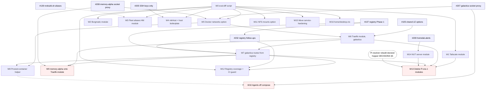

# Fleet refactoring plan: shared modules

What to extract into shared modules, in what order, and how to prove each
step changed nothing it should not have. Written against `main` at `16c2d7b`
and the open pull requests as of 2026-11-08.

This supersedes the survey in #39 and the checklist in #40: both predate
`luks-remote-unlock.nix`, the agent modules, the fleet registry (#107) and the
decision to rebuild the Pis as resolver replicas (`hosts/hopper/DECISIONS.md`
§5). Where this plan and `docs/FLEET-REGISTRY.md` (#232) describe the same
work, the registry doc owns the registry's shape and this one owns the order.

## 1. Ground rules

**One concern per PR, `[all]` or `[host]` scoped as `CLAUDE.md` says.** Every
item below is sized to be one PR. Items that change what a host runs say so and
name the hosts that must switch.

**Pure refactors are proven, not asserted.** The proof is that each host's
system closure is the same before and after. Two things make this harder than
it sounds, and both have bitten PRs here already:

- `toplevel.drvPath` is not a usable no-op check in this repo. `motd.nix`
  bakes `self.rev` into the closure, so two byte-identical checkouts at
  different commits evaluate to different paths (#105 found this; #107 and
  #232 worked around it). The working method is: `git archive` both trees,
  evaluate each as a `path:` flake, and compare toplevel paths per host. For a
  change that is meant to be a no-op on some hosts and not others, the per-host
  table in #107's description is the shape to copy.
- galactica cannot be evaluated from a sandboxed session, because the private
  `nixflix` input needs a token. CI evaluates it. A PR that touches galactica
  says which of its claims CI proved and which were proved on a standalone eval
  of the module.

Item W0 below turns that method into a script so later PRs stop re-deriving
it, and the registry roadmap's "CI no-op guard" is the same idea as a flake
check.

**Delete before abstracting.** #39's one piece of advice that still holds. The
Pi era-1 modules are not refactor candidates; they are deletions waiting on the
resolver rebuild (W13).

**A deployed host is the only real test for anything with runtime behaviour.**
W9 (memory-alpha's Traefik) and W10 (agents) change what runs. They carry
deploy checklists, and they go one host at a time.

## 2. Open PRs this plan builds on, or retires

Checked against `main` with `git merge-tree` on 2026-11-08.

| PR | What it does | vs `main` | This plan |
|---|---|---|---|
| #105 | Shared `homelab.letsencryptEmail` and `letsencryptCaServer` in all four Traefik modules | clean | Merge first. W6 assumes it. |
| #107 | Fleet registry Phase 1: `fleet/{hosts,services,lib}.nix`, `modules/nixos/fleet.nix`, generated AdGuard rewrites | clean | Merge first. W7 and W12 build on it. |
| #232 | Registry follow-ups: plane names `internal`/`private`/`public`, `docs/FLEET-REGISTRY.md` roadmap | stacked on #107 | Merge after #107. |
| #205 | SSH public keys only, boot generation cap | stacked on #107, dirty | Retarget to `main` after #107; unrelated to this plan but touches `common.nix`, so land it before W4. |
| #207 | galactica beszel-agent via the socket proxy, proxy off the shared network | conflicts | Rebase and merge before W5 and W10: it adds the `dockerHost` option W10 keeps. |
| #208 | memory-alpha socket proxy on its own compose network, pinned | clean | Merge before W9, which replaces the compose file it edits. |
| #209 | `homelab.alerts`: ZED, smartd and failed-unit alerts to ntfy | clean | Merge. W14 uses it instead of `nut.nix`'s own ntfy script. |
| #139 | `nrs`/`nrt`/`drs` through `scripts/nrebuild.sh` with a branch banner | conflicts | Decide before W3. W3 generates whatever alias shape #139 settles on. |
| #36 | pegasus Beszel agent via nixpkgs' native `services.beszel.agent` | conflicts, Aug 2026 | Superseded by `beszel-agent.nix` on `main`. Close, but W10 takes its finding: nixpkgs has a native agent module. |
| #84 | Colmena hive | conflicts, galactica missing | Park. W4's `mkHost` should expose each host's module list so `colmena.nix` can consume it instead of re-listing modules, which was #84's stated pain. Revisit after W4. |
| #141 | Home Assistant on memory-alpha as a compose-in-systemd container | conflicts, large | Not a refactor PR, but its `home-assistant.nix` is a future W8 consumer and it edits `traefik.nix`, so it should land before or be rebased after W9, not during. |
| #39 / #40 | Unification survey and tracking issue | docs only | Close #39. Replace #40's checklist with a pointer here, or close it. |

Everything else open (#113, #156, #174, #176, #190, #204, #224, #227, #231,
#235 to #238, #242, #244, #245) is host work that does not overlap this plan,
except that #174 touches `smart.nix` and #156 adds containers to memory-alpha;
neither changes what follows.

## 3. Work items

Each item: what it extracts, the files it touches, what proves it, which hosts
switch, and what it depends on. "No-op" means every host's toplevel is
unchanged by the W0 check.

### W0. No-op proof script and CI guard

`scripts/eval-diff.sh <ref-a> <ref-b>`: `git archive` both refs into scratch
directories, evaluate every `nixosConfigurations.*` and
`darwinConfigurations.*` toplevel as a `path:` flake, and print a per-host
changed/unchanged table. Optional `--nvd` runs `nvd diff` on the pairs that
changed. Reuses the git+https rewrite from
`.claude/hooks/flake-check-sandboxed.sh` so it works in a sandboxed session for
every host but galactica.

Second half, later: a `checks.x86_64-linux.rewrites-snapshot` output that
asserts galactica's generated AdGuard rewrite set, the registry roadmap's "CI
no-op guard". That half waits for W7.

- Files: `scripts/eval-diff.sh`, `CLAUDE.md` (one line under Workflow).
- Proof: run it on `main` against `main`, every host unchanged; run it on
  #105's branch, every host unchanged.
- Hosts: none.
- Depends on: nothing. Everything mechanical below cites it.

### W1. Tailscale client module

`modules/nixos/tailscale.nix` becomes `homelab.tailscale = { enable; exitNode
= false; ssh = true; }`. It owns the sops secret, `services.tailscale`,
`trustedInterfaces` and the UDP port. hopper keeps `exitNode = true`; pegasus,
galactica and hamilton drop their hand-written blocks. pegasus's extra printer
UDP ports stay in its configuration.

- Files: `modules/nixos/tailscale.nix`, four `configuration.nix`.
- Proof: no-op on all four hosts.
- Hosts: none switch for the refactor itself.
- Depends on: W0.

### W2. Borgmatic fleet module

`modules/nixos/borgmatic.nix`, `homelab.borgmatic`, owning what the three host
files share: the BorgBase repository URL built from an account id, the archive
name format derived from the label, `encryption_passcommand`, the `ssh_command`
with the pinned `known_hosts`, zstd, cache excludes, `skip_actions = compact`,
the `checks` list, both sops secrets at `/var/lib/borgmatic/ssh/`, the
`LoadCredentialEncrypted` reset and the `OnCalendar` reset. Per-host options:
`repoAccount`, `label`, `schedule`, `retention`, `extraCapabilities`,
`secretsOwner`, and a free `settings` attrset merged last for the ZFS hook, the
SQLite dumps and the path excludes.

- Files: new module, three `hosts/*/borgmatic.nix` shrink to their differences,
  `docs/BACKUP.md` loses the archive-name drift warning because the module
  makes drift impossible.
- Proof: no-op on galactica, memory-alpha, pegasus. `services.borgmatic`
  renders the config to a store path, so the rendered YAML can be diffed
  directly as a second check.
- Hosts: none switch for the refactor itself.
- Depends on: W0.

### W3. Fleet rebuild aliases as a Home Manager module

`modules/home/fleet-aliases.nix` reads `osConfig.networking.hostName` (pegasus
already does) and the flake attribute, and generates `nrs`, `nrt`, `npull`,
`npullnrs`, or `drs`/`npulldrs` on darwin, plus the `unlock-*` and
`ipmi-tower-*` recovery aliases with the repo path as an option. The recovery
aliases are deliberately on both admin boxes (`hosts/galactica/PLATFORM.md`
§2); one definition on two hosts keeps that. galactica, hamilton, hopper and
memory-alpha `home.nix` reduce to a stateVersion, or vanish into
`common.nix`'s `sharedModules`.

- Files: new module, six `home.nix`, `modules/nixos/common.nix` if shared.
- Proof: no-op on all hosts. The rendered `home.shellAliases` can be
  compared as a second check.
- Hosts: none.
- Depends on: W0, and a decision on #139 (the alias target changes from
  `sudo nixos-rebuild` to `nrebuild.sh`). Either order works; doing #139 first
  means W3 generates the final shape once.

### W4. Host boilerplate and `mkHost`

Three mechanical lifts. `common.nix` derives `sops.defaultSopsFile` from the
hostname and sets `age.sshKeyPaths`; `common.nix` sets the home-manager block
with `users.z = import (../../hosts + "/${hostName}/home.nix")`, or each host
keeps a one-line `users.z` if the path trick reads as too clever. `flake.nix`
gains `mkHost { system; modules; extraSpecialArgs ? {}; hmSharedModules ? []
}` wrapping `nixosSystem`, home-manager, `appsForHm` and sops-nix, and exposes
the per-host module list as `self.lib.hostModules.<host>` so a future Colmena
hive (#84) can read it. pegasus's `hasSops` gate in its borgmatic file goes.

- Files: `flake.nix`, `modules/nixos/common.nix`, five `configuration.nix`,
  `hosts/pegasus/borgmatic.nix` (folds into W2 if W2 lands first).
- Proof: no-op on all hosts.
- Hosts: none.
- Depends on: W0; #205 merged first since it also edits `common.nix`.

### W5. Declarative Docker networks

`homelab.docker.networks.<name> = { options = ""; consumers = [ units ]; }`
generates the inspect-or-create oneshot. Bambuddy's version is the template:
it labels the network with a hash of its options and recreates on mismatch,
which the other six copies cannot do. The `proxy` network is declared once by
the Traefik module (W6) and consumers add themselves. `virtualisation.oci-
containers.backend = "docker"` moves to `common.nix` beside `docker.enable`.

- Files: new `modules/nixos/docker-networks.nix`, `traefik*.nix` (four),
  `karakeep.nix`, `paperless.nix`, `bambuddy.nix`, `common.nix`.
- Proof: not a strict no-op, because the generated oneshot gains the label
  check. Per host: the unit list is unchanged, each unit's `Before`/
  `RequiredBy` set is unchanged, and the `ExecStart` differs only by the label
  logic. On first switch each network is recreated once if it has no label;
  the PR says so and lists the consumers that restart.
- Hosts: galactica and memory-alpha switch, one at a time.
- Depends on: W0, #207 and #208 merged (they move the socket proxy's network).

### W6. One Traefik module, galactica first

`traefik-galactica.nix` becomes `modules/nixos/traefik.nix`, option prefix
`homelab.traefik`, with: `domainGroups.<name> = { base; flat = false;
upstreams; }` generalising `mkDomainGroup` so a `flat` group produces
`name.internal` and `name.zjones.dev` for the dashboards and the single
containers; `dashboard = { enable; authSecret; }` for the memory-alpha style
basic-auth dashboard; `dockerProvider.enable`; `extraRouters` for the few
hand-shaped routes like `jellyfin-xyz`. `arrExtraUpstreams` and `readUpstreams`
become `domainGroups.arr.upstreams` and `domainGroups.read.upstreams` with
the old names kept as aliases for one release. The old compose `traefik.nix`
is renamed `traefik-compose.nix` until W9 deletes it, so the name is free.

- Files: `modules/nixos/traefik-galactica.nix` (renamed), `traefik.nix`
  (renamed), galactica's imports, `bazarr.nix`, `reading-*.nix`.
- Proof: no-op on galactica via CI. Standalone eval of the module in a
  minimal NixOS config shows the rendered dynamic config identical for the
  `arr` and `read` groups.
- Hosts: none switch.
- Depends on: W0, #105, W5.

### W7. galactica routes from the registry (registry Phase 2)

Every galactica service that today hand-writes a router pair registers an
upstream instead, and the module joins that with `fleet/services.nix` to
produce the routers: `homelab.traefik.routes.<name>.upstream = "http://
127.0.0.1:3020"` in the service's own file keeps the port written once where
the service is defined, and the registry stays the authority on names and
planes. Assertions: every registry service whose `host` is this machine has an
upstream here, and every upstream here is in the registry. The `maker` group
is a wildcard group, which the registry cannot express yet (W12), so it stays a
`domainGroups.maker` entry in this step with its three upstreams registered
the same way. `adguard`'s pair in `configuration.nix` moves to `dns.nix` as
`homelab.dns.adminRoute = true`, since hopper and hamilton's Traefik modules
hand-write the same pair.

This settles `docs/FLEET-REGISTRY.md`'s open decision 1: Phase 2 is galactica
routes from the registry; Phase 3 is memory-alpha and `jellyfin.internal`
(W9).

- Files: ten `hosts/galactica/*.nix`, `homepages.nix`, `configuration.nix`,
  `dns.nix`, `modules/nixos/traefik.nix`, `fleet/services.nix`,
  `docs/FLEET-REGISTRY.md`.
- Proof: no-op on galactica via CI: same router names, same rules, same
  services, same `domains` lists. Rendered `dynamicConfigOptions` compared
  sorted.
- Hosts: none switch.
- Depends on: W6, #107, #232.

### W8. Proxied-container helper

`homelab.containers.<name> = { image; port; containerPort; dataDir; owner ?
root; environment; secretEnv; extraVolumes; tsdproxy ? true; group ? "flat";
}` generates the tmpfiles rule, `RequiresMountsFor`, the loopback publish,
the tsdproxy label triple, the sops env template, and the W7 route
registration. Asserts loopback ports are unique on the host, replacing the
"next free slot" comments. ferdium, memos, homebox, spoolman, partdb and the two
homepages are the first consumers; karakeep and paperless use it for their web
container and keep their sidecars as plain `oci-containers`; syncthing stays
hand-written because of host networking. bambuddy on memory-alpha follows after
W9. #141's Home Assistant and #156's slicers are later consumers.

- Files: new `modules/nixos/containers.nix`, ten galactica files.
- Proof: no-op on galactica via CI, container by container.
- Hosts: none switch.
- Depends on: W5, W7.

### W9. memory-alpha onto the shared Traefik module (registry Phase 3)

Replace the compose stack in `traefik-compose.nix` with `homelab.traefik` on
memory-alpha. This is the one Traefik step with runtime risk, so it is its own
PR with a deploy checklist:

- ACME storage moves from `/home/z/traefik/letsencrypt/acme.json` to
  `/var/lib/traefik/acme.json`. Copy it before the switch, or every cert is
  re-issued against production limits. The staging flag's separate storage
  path makes a dry run possible.
- The Docker provider stays: Arcane and the `homelab-stacks` compose projects
  publish routes by label, and `--providers.docker.network=proxy` and the
  `br-proxy` trusted interface must survive. The socket proxy from #208 stays
  and moves to loopback as on galactica.
- The three wildcard SANs (`memory-alpha`, `monitor`, `3dp`) become three
  `domainGroups`. `jellyfin` and `jellyfin-xyz` come from the registry's
  `private` and `public` planes, and `jellyfin.internal` turns on, which is the
  registry roadmap's Phase 3 item.
- `secure-headers` and `dashboard-auth` middlewares move from labels to the
  file provider.
- `host.docker.internal:8096` becomes `127.0.0.1:8096`.

- Files: `traefik-compose.nix` deleted, `hosts/memory-alpha/configuration.nix`,
  `jellyfin.nix`, `arcane.nix` (its network dependency), `fleet/services.nix`,
  `hosts/memory-alpha/MANUAL-STEPS.md`.
- Proof: not a no-op. `nvd diff` shows the compose unit gone and
  `traefik.service` added. The rendered dynamic config lists the same router
  rules as the old compose labels plus `jellyfin.internal`.
- Hosts: memory-alpha switches, with the acme.json copy first. Expect one
  edge restart.
- Depends on: W6, W7, #208; #141 landed or rebased.

### W10. Agents off compose

`beszel-agent.nix` moves to nixpkgs' `services.beszel.agent` if the 26.05
module exists and supports the KEY, TOKEN and HUB_URL trio (#36 says it does;
verify against the pinned nixpkgs first). `arcane-agent.nix`,
`scrutiny-collector.nix` and `adguardhome-sync.nix` become plain
`oci-containers` entries with `sops.templates` env files, the shape `tsdproxy.nix`
already uses. The compose wrapper, `ExecStop` and secret-export script go. The
`dockerHost` option from #207 stays.

- Files: four modules.
- Proof: not a no-op. Per host, `nvd diff` shows each `X.service` replaced by
  `docker-X.service`, and the rendered container environment matches the old
  compose environment key for key.
- Hosts: galactica and pegasus switch (memory-alpha's agents live in
  `homelab-stacks`, outside this repo).
- Depends on: #207; W8 only for consistency of shape.

### W11. NFS client mounts

`homelab.nfsMounts.<path> = { export; extraOptions ? []; }` with the fleet's
eleven default options. memory-alpha's two mounts and bambuddy's library mount
use it; bambuddy's missing `rsize`/`wsize`/`async`/`nconnect` become either an
explicit opt-out or are adopted, and the PR says which.

- Files: new `modules/nixos/nfs-mounts.nix`, `hosts/memory-alpha/
  configuration.nix`, `bambuddy.nix`.
- Proof: no-op if the options are kept per mount; otherwise `nvd diff` shows
  only the three `.mount` units.
- Hosts: memory-alpha if options change.
- Depends on: W0.

### W12. Registry coverage

From `docs/FLEET-REGISTRY.md`: a wildcard-group scope so `*.maker`, `read.*`
and `*.3dp` come from the registry; host identities (`galactica`/`tower`/
`arr`, `hopper.internal`) from `hosts.nix`; and the rewrites-snapshot flake
check from W0. After this, galactica's hand-written rewrite list is empty and
the `maker` group in W7 collapses into the registry.

- Files: `fleet/*.nix`, `modules/nixos/fleet.nix`, `configuration.nix`,
  `modules/nixos/traefik.nix`, `checks/rewrites-snapshot/`.
- Proof: no-op on galactica (rewrite set identical, compared sorted).
- Hosts: none.
- Depends on: W7, #232.

### W13. Pi era-1 modules: delete, after the resolver rebuild decision

`hosts/hopper/DECISIONS.md` §5 says the Pis return as ephemeral resolver
replicas and that the module set must be trimmed to resolver plus Tailscale.
Once that decision is executed, `beszel.nix`, `ntfy.nix`, `uptime-kuma.nix`,
`homepage.nix`, `speedtest-tracker.nix`, `traefik-local.nix`,
`traefik-hamilton.nix` and the rootless-Docker assumptions in them are
deleted. The Pis import `dns.nix` with `adminRoute` (W7) and the shared
Traefik module (W6) for that one pair, or no Traefik at all if the AdGuard UI
is reached over Tailscale only. `nut.nix` is deleted after W14 salvages it.

- Files: eight modules, two `configuration.nix`, `rpi-common.nix` stays.
- Proof: hopper and hamilton toplevels change; nothing else does.
- Hosts: the Pis, as part of their rebuild.
- Depends on: W1, W6, W7, W14, and the owner's decision in hopper DECISIONS
  §5 item 1.

### W14. NUT server module for galactica

`hosts/galactica/MANUAL-STEPS.md` §6 wants galactica as the UPS server, and
`configuration.nix` says `nut.nix` is hopper's own config, not a template.
Make it one: `homelab.nut.server = { upsName; driver; description; }` with
notifications through `homelab.alerts` (#209) instead of `nut.nix`'s own curl
script. hopper's module becomes the first (dead) consumer and galactica the
live one when its UPS steps are done.

- Files: `modules/nixos/nut.nix` rewritten, `nut-client.nix` unchanged.
- Proof: hopper no-op until the ntfy path changes; galactica gains units.
- Hosts: galactica, when §6 is executed.
- Depends on: #209; W13 deletes the old copy afterwards.

### W15. Move `service-hardening.nix` out of the host directory

`hosts/galactica/service-hardening.nix` is a generic systemd hardening set.
It moves to `modules/nixos/lib/service-hardening.nix` and the two importers
update.

- Proof: no-op on galactica.
- Depends on: W0.

### W16. `modules/home/desktop.nix`

#40 step 4, still valid: the CLI overlap between pegasus and serenity (`sl`,
`claude-code`, `_1password-cli`, `unzip`, `freeipmi`, `expect`, `nmap`,
`sops`) in one Home Manager module both import. GUI apps stay per host for the
cask-versus-nixpkgs reason #40 records.

- Proof: no-op on pegasus and serenity if the package set is unchanged.
- Depends on: W0. Independent of everything else.

## 4. Dependency graph

PR nodes are the open pull requests this plan waits on. The dashed node is a
decision only the owner can make.

Dashed edges are soft: the later item works without the earlier one but is
simpler after it.

## 5. Sequence

Three waves. Items inside a wave are independent and can go in any order or
in parallel sessions.

**Wave 1, mechanical, all no-ops.** Merge #105, #107, #232, #205, #208, #209.
Rebase and merge #207. Decide #139. Then W0, and in any order W1, W2, W3, W4,
W11, W15, W16. Each is one `[all]` PR, proven by W0, switched at leisure since
nothing changes on the hosts.

**Wave 2, galactica's Traefik, still no-ops.** W5, then W6, then W7, then W8,
then W12. galactica switches once at the end of W5 (networks relabelled) and
otherwise does not need to. CI is the proof for every step since galactica
cannot be evaluated in a sandbox.

**Wave 3, runtime changes, one host per PR.** W9 (memory-alpha's edge), W10
(agents on galactica and pegasus), W14 when galactica takes the UPS, W13 when
the Pis are rebuilt. Each carries a deploy checklist in the PR body and a
`MANUAL-STEPS.md` section keyed by its PR number.

## 6. Not in scope

- Pegasus's desktop modules (`desktop-*`, `nvidia`, `gaming`, `performance`,
  `keyring`, `dankcalendar`, `dux-files`, `hushmic`, `nzxt-kraken`,
  `monitor-speakers`, `ollama`, `olla-router`, `keyboards`, `mouse-tools`,
  `printing`, `yubikey`, `virt-manager`): single consumer, host-shaped,
  correctly in `modules/` for readability. Nothing to extract.
- `luks-remote-unlock.nix`, `letsencrypt.nix`, `smart.nix`,
  `serial-console.nix`, `btrfs-snapshots.nix`, `rpi-common.nix`, `motd.nix`:
  already shared, leave alone.
- GUI app parity between pegasus and serenity: a roster problem, not a module
  problem (#40 step 5).
- `withBambuddyCa` in `flake.nix` and `modules/darwin/slicer-certs.nix`: two
  platforms' implementations of one idea, correctly separate.

## 7. Open decisions

1. [ ] **#139 first or W3 first.** Recommendation: #139 first, so W3 generates
   the final alias shape once.
2. [ ] **W4's home-manager path trick.** `import (../../hosts + "/${hostName}/
   home.nix")` in `common.nix` versus one `users.z = import ./home.nix` line
   per host. Recommendation: keep the one line per host; the trick saves four
   lines and costs a reader a lookup.
3. [ ] **W7's upstream location.** Port in the registry entry versus port in the
   service file joined by name. Recommendation: service file, as written above,
   so a port change is one edit where the service is defined.
4. [ ] **W9 timing relative to #141.** Land Home Assistant on the compose
   Traefik first and migrate it with W9, or rebase #141 onto the shared module
   after W9. Recommendation: after, since #141 is large and W9 changes the file
   it edits.
5. [ ] **W10's Beszel agent.** Native nixpkgs module or `oci-containers`. Decide
   after checking the pinned nixpkgs for `services.beszel.agent` and whether it
   takes TOKEN and HUB_URL.
6. [ ] **Whether #84 (Colmena) comes back after W4**, or deploys stay
   `nixos-rebuild --target-host`.
